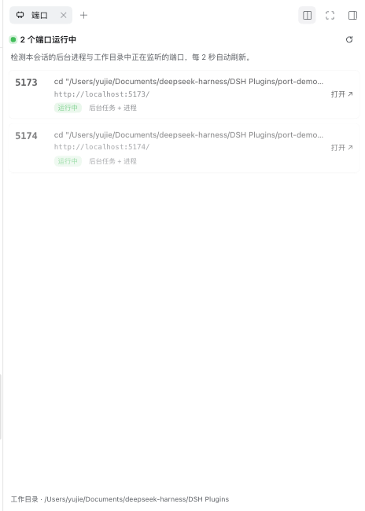
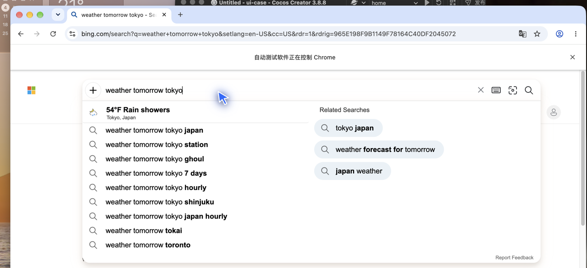

# Yujie's DSH Plugins

Two small plugins for DeepSeek Harness. Once installed:

- **Session Ports** — the pages and services a conversation starts, listed in the right sidebar. Click one and it opens.
- **CDP Browser Control** — lets the assistant drive a real browser window: click, read, and take screenshots for you.

No code to write, no commands to run.

English | [中文](README.md)

---

## What this actually is

This is a **plugin market index**, not the software itself.

Paste its address into DSH and the two plugins below show up under **Plugins → Discover**, ready to install. After that they live inside DSH and you just keep talking to the assistant — no buttons or commands to remember.

---

## 1. Session Ports

> The page your assistant built, one click away.

### When it helps

Ask the assistant to "build a page so I can see it", "start a local server", or "give me a preview", and it starts a local server in the background. That address used to exist only in a wall of scrolling log output, where you had to scroll up and find something like `http://localhost:5173`.

With this plugin, the conversation's right sidebar lists:

- the port number (5173, 8000, …)
- the command that started it
- a clickable address

### How to use it

1. Ask the assistant to start a service, as usual.
2. A port icon appears on the right of the conversation header; a number next to it means that many services are running.
3. Click it, the right sidebar opens **Ports**, click any row to open it in your browser.



A green dot means the port is **actually** listening — not merely mentioned in a log, and not a leftover from a service that already exited. When a service stops, the row disappears on the next refresh.

The plugin only reads local port data and working directories. It does not use the network and does not touch your files.

---

## 2. CDP Browser Control

> A browser of the assistant's own.

### When it helps

- "Check whether this page loads."
- "Log in and fill in this form."
- "What is the page complaining about? What does the console say?"
- "Take a screenshot of this page for me."

### What it does

The assistant opens a real Chrome or Edge window, and you can watch it work: the cursor moves onto an element first, then clicks.

By default it reads the page **structure** — which buttons, inputs, and text exist and what they are called — and takes a screenshot only when it needs to look. So it aims at elements it recognises rather than guessing coordinates.



### Two things worth knowing

- **It is its own browser.** It uses a separate profile directory and never touches the browser you normally use: your bookmarks, logins, and extensions are untouched, and it cannot borrow your logged-in sessions either.
- **A banner at the top says the browser is being controlled.** That is the browser's own notice; ignore it. It goes away when the browser closes.

---

## Install

### Requirements

- DeepSeek Harness for desktop, `0.2.x`.
- **Access to GitHub.** Both the index and the plugin code come from GitHub (`github.com` and `raw.githubusercontent.com`). On a network that cannot reach them, installation fails — there is no other distribution channel for this repository.

### Steps

1. Open DSH and click **Plugins** in the left rail.
2. Switch to **Discover**. On first use you will see an empty state — click **Add index source**. If you added one before, open **Manage index sources…** from the menu at the top right.
3. Paste this address and save:

   ```text
   https://raw.githubusercontent.com/yujieco/yujie-dsh-plugins/main/index.json
   ```

4. **Session Ports** and **CDP Browser Control** appear in the list. Select one and click **Install**.

The two plugins are independent: install either or both.

### Restart DSH once after installing

Part of a plugin loads when the interface starts, so its buttons do not appear right away. **Quit DSH completely and open it again** — then they will.

---

## Troubleshooting

**Installed, but I cannot find it in the interface.**

Restart DSH: quit it fully and reopen, not just close the window.

**The ports panel is empty.**

A service has to be running. If the assistant started it as a foreground task, the port is gone once that task ends. Ask it to run the service in the background, or confirm the service is still alive.

**Clicking a port does not open.**

Addresses are always `http://localhost:PORT`. A few services listen on IPv6 only, and some have already exited — both fail to open.

**The assistant has a browser open and I want to use the mouse myself.**

You can operate that window directly. The assistant is still in control, though, so tell it to "close the browser" first.

**Will it touch my own browser data?**

No. It uses a separate profile directory.

**How do I remove it?**

**Plugins → Installed**, find the plugin, and switch it off or uninstall it. Disabling removes the button and the panel together and does not affect anything you are working on.

**A new version was released — what do I do?**

Open **Plugins → Discover**, select the plugin; when an update is available an update button appears. Click it, then restart DSH again.

---

## About

Maintained by [yujieco](https://github.com/yujieco). Please open plugin issues in [Issues](https://github.com/yujieco/yujie-dsh-plugins/issues).

Released under the [MIT License](LICENSE).
