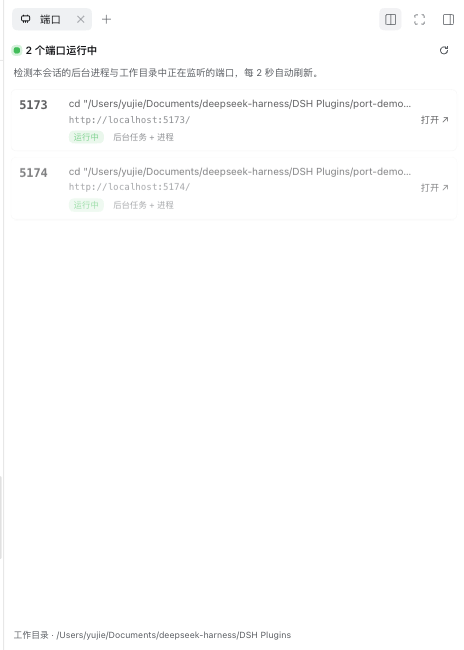
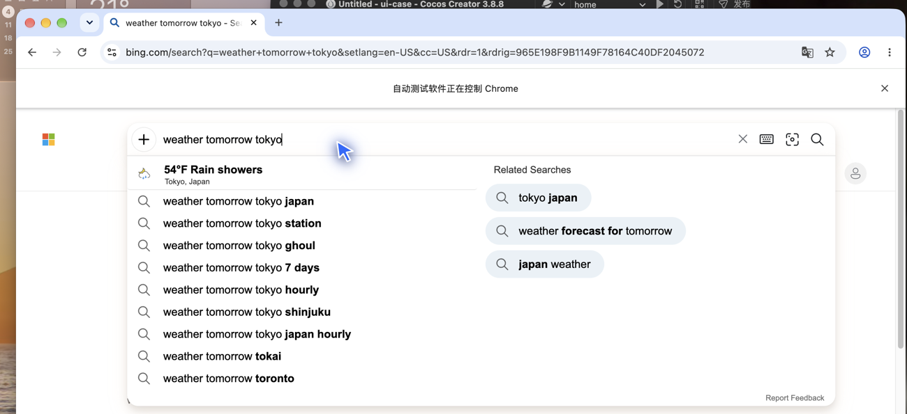

# Yujie 的 DSH 插件

两个给 DeepSeek Harness 用的小插件。装上之后：

- **会话端口** —— 会话里跑起来的网页或服务，右侧栏列出来，点一下就打开。
- **CDP 浏览器操控** —— 让助手真的开一个浏览器窗口，自己点、自己读、自己截图给你看。

不用写代码，也不用敲命令。

[English](README.en.md) | 中文

---

## 先说清楚这是什么

这是一份**插件市场索引**，不是软件本体。

你在 DSH 里把它的地址填进去，`插件 → 发现` 里就会出现下面这两个插件，点「安装」就行。装完之后它们常驻在 DSH 里，你照常跟助手说话即可——不需要记住任何按钮或命令。

---

## 一、会话端口

> 助手做出来的页面，一点就开。

### 什么时候用得上

你让助手「做个页面看看」「起个本地服务」「给我个预览」，它会在后台启动一个本地服务器。以前这个地址只出现在飞速滚动的日志里，你得往上翻着找 `http://localhost:5173` 这样的字。

装上这个之后，会话右侧栏会直接列出：

- 端口号（5173、8000……）
- 启动它的命令
- 一个能点的地址

### 怎么用

1. 像平常一样让助手起服务。
2. 会话标题栏右侧会多出一个端口图标，旁边有数字就表示当前有几个服务在跑。
3. 点它，右侧栏展开「端口」，点任意一行就在浏览器里打开。



绿点表示端口**真的**在监听——不是日志里提到过、也不是早就退出的残留。服务停掉后，下一次刷新就自己消失了。

它只读取本机的端口列表和工作目录，不联网，也不改你的文件。

---

## 二、CDP 浏览器操控

> 给助手一个自己的浏览器。

### 什么时候用得上

- 「帮我看看这个网页能不能打开」
- 「登录进去，把这个表单填了」
- 「页面上哪里报错了，控制台说了什么」
- 「把这个页面截个图给我」

### 它会怎么做

助手会打开一个真实的 Chrome 或 Edge 窗口，而且你能看着它操作：鼠标先移动到一个元素上，再点下去。

它默认读的是页面的「结构」——有哪些按钮、输入框、文字，各自叫什么——需要看图时才截图。所以它通常是认准元素再点，不是靠猜坐标。



### 两点要留意

- **这是它自己的浏览器。** 用的是独立配置目录，不碰你平时用的那个浏览器：你的书签、登录状态、扩展都不受影响；反过来，它也用不上你的登录状态。
- **窗口顶上有一条「正在控制」的横幅。** 那是浏览器自己的提示，不用管，关掉浏览器就结束了。

---

## 安装

### 前提

- DeepSeek Harness 桌面版 `0.2.x`。
- **能访问 GitHub**。索引和插件代码都由 GitHub 提供（`github.com` 与 `raw.githubusercontent.com`）。公司网络或部分网络环境访问不了的话，安装会失败——这一点绕不过去，因为这个仓库没有别的分发渠道。

### 步骤

1. 打开 DSH，点左侧 **插件**。
2. 切到 **发现**。第一次用会看到空状态，点 **添加索引源**；之前加过的话，从右上角菜单进 **管理索引源**。
3. 粘贴下面这个地址，保存：

   ```text
   https://raw.githubusercontent.com/yujieco/yujie-dsh-plugins/main/index.json
   ```

4. 列表里出现「会话端口」和「CDP 浏览器操控」，选中一个点 **安装**。

两个插件各自独立，装一个或都装都可以。

### 装完要重启一次 DSH

插件有一部分代码在界面启动时加载，所以刚装完按钮不会立刻出现。**完全退出 DSH 再打开**，就有了。

---

## 常见问题

**装了，但界面上找不到。**

重启 DSH——完全退出再打开，不是收起窗口。

**端口面板是空的。**

服务真在跑才显示。如果助手是在前台任务里跑的，任务一结束端口也就没了。让它用后台任务跑，或者先确认服务还活着。

**点了端口打不开。**

地址统一是 `http://localhost:端口`。少数服务只监听 IPv6，或者已经退出了，就会打不开。

**助手开着浏览器，我想自己用鼠标点。**

那个窗口你现在就能直接操作。不过助手还在控制它，建议先跟它说一句「关掉浏览器」。

**会不会动到我自己的浏览器数据？**

不会。插件用的是独立配置目录。

**不想要了怎么卸载？**

`插件 → 已安装`，找到对应插件，用开关停用，或者卸载。停用后按钮和面板一起消失，不影响你正在做的事。

**插件出更新了，我要做什么？**

`插件 → 发现` 里选中插件，有新版时会出现更新按钮，点一下即可，更新完同样重启一次 DSH。

---

## 关于

维护者 [yujieco](https://github.com/yujieco)。插件问题请开在 [Issues](https://github.com/yujieco/yujie-dsh-plugins/issues)。

本项目以 [MIT 许可证](LICENSE) 发布。
