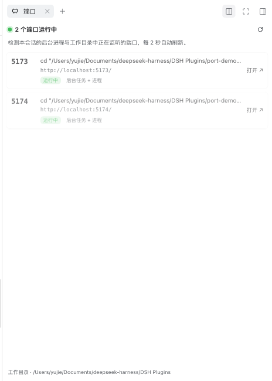

# yujie-dsh-plugin-sider-motion · Session Ports

> A DeepSeek Harness plugin that lists the ports the current session is serving in the right sidebar, and opens any of them in your browser with one click.

English | [中文](README.md)



---

## 1. Why this plugin exists

In Harness, sessions that build a website, an API, or a preview almost always start a local server in the background: `npm run dev`, `vite`, `next dev`, `python -m http.server`, `uvicorn`, and so on.

The port number then lives in exactly two places: **fast-scrolling tool output**, and **your memory**.

This plugin lifts "what is this session serving?" out of the log and turns it into a persistent, visible, clickable session-level fact. The point is not only saving a few copy-paste cycles:

- **Hidden state becomes a visible surface.** What is running, on which port, and whether it is still alive is one glance away instead of a scroll back through history.
- **Verification goes back to being verification.** Click through to the page instead of hunting for `http://localhost:5173` in twenty lines of output.
- **Multi-service sessions become readable.** Frontend on 5173, API on 5174, docs on 8000 — one row each, with the launching command and its source, so you never click the wrong one.
- **Ports stay scoped to the session.** The list belongs to the session you are in, not to the machine, so switching sessions does not mix them up.

## 2. Problems it solves

| Real pain | What the plugin does |
| --- | --- |
| Ports only appear inside scrolling tool output | Parses ports from background job commands and their output, then keeps them in the sidebar |
| Unclear whether a port is still alive | A real TCP probe per candidate; only a green dot means "listening" |
| Mentioning a port is not serving it | Commands count only when they start a server; output counts only when it is a server's startup banner |
| Several services in one session look alike | Each row shows port, launch command, URL, source tag, and working directory |
| `127.0.0.1:5173` fails because Vite binds `[::1]` only | Links use `http://localhost:PORT/`, and probing covers both loopback families |
| Switching sessions or workspaces loses the context | Ports are per session; listener processes are attributed by working directory |

## 3. Features

- **Header entry** — a port icon in the session title row, with the running count beside it.
- **Right Sidebar page** — one card per port: status dot, port number, launch command, openable URL, and source (background job / job output / workspace process).
- **One-click open** — click the card or **Open ↗** to open the port in a new browser tab.
- **Live refresh** — the panel polls every 2 s (paused while the page is hidden) and the header entry every 5 s; loading, empty, and error states each explain themselves, and failures offer Retry.
- **Restrained motion** — a short fade/rise for the panel and its rows, disabled under `prefers-reduced-motion`.
- **Theme and locale aware** — only host `--dsw-alias-*` theme tokens; copy runs through the locale service in Chinese and English.

## 4. How "running" is decided

Two sources of evidence on the Host plus one real probe:

1. **The session's background jobs** (`ctx.jobs`)
   - **Command line** — only counted when the command itself starts a server (`vite`, `next dev`, `npm run dev`, `python -m http.server`, `uvicorn`, `flask run`, `docker compose up`, …). A `curl http://localhost:3000` merely *mentions* a port.
   - **Retained output** — only counted when it contains a server's startup banner (`Local:`, `Network:`, `Listening on`, `Serving HTTP on`, `ready in`, …).
2. **Real listening processes** — `lsof -iTCP -sTCP:LISTEN` (`netstat -ano` on Windows) enumerates listeners; each process's working directory is read, and only those inside the **session's working directory** (subdirectories included) are attributed to it.
3. **TCP probe** — every candidate is tried against both `127.0.0.1` and `::1`; a connection on either means "running".
4. **Noise removal** — a settled job whose port refuses connections is history, not something this session is serving, so it is not shown.

## 5. Install

Requires DeepSeek Harness `0.2.x` (desktop; the Web GUI is served over local HTTP). The plugin has no runtime dependencies.

### From the central plugin market (recommended)

In DSH open **Plugins → Discover** and add an index source:

```text
https://raw.githubusercontent.com/yujieco/yujie-dsh-plugins/main/index.json
```

Then select **Session Ports** in the market and press **Install**. The market installs from a pinned Git commit, so you get exactly the published bytes.

### From source

```bash
git clone https://github.com/yujieco/yujie-dsh-plugins.git
```

Install `plugins/sider-motion` as a local bundle (ask the agent to run it):

```text
plugin_manager
  action: install_bundle
  target: /absolute/path/to/yujie-dsh-plugins/plugins/sider-motion
```

A successful install returns `application: applied`; the plugin row id is `sider-motion`. Installing enables it.

## 6. Open, enable, disable

| Action | How |
| --- | --- |
| **Open the panel** | In any session, click the port icon at the right of the title row (it carries a count when ports are running); the right Sidebar opens on the **Ports** tab |
| **Enable / disable** | Settings → Plugins → find **Session Ports** in the installed list and toggle it; or have the agent call `plugin_manager` `set_plugin` with `target: include:sider-motion` |
| **Uninstall** | `plugin_manager` `remove_bundle` with `target: yujie-dsh-plugin-sider-motion` |

Disabling removes the header entry and the tab together; it does not touch the session or the servers it started.

## 7. Usage

Start a server in the session (a background job keeps it alive):

```bash
python3 -m http.server 8000
npm run dev -- --port 5173
```

The port appears in the sidebar within seconds; click the row or **Open ↗** to view it. When the server stops, the row disappears on the next refresh.

## 8. Architecture

- **Host half** (`index.js`) — registers a read-only route on `ctx.webServer`: `GET /plugin/session-ports/list?sessionId=…` (plus a lightweight `/count`) returning JSON. The route sends no CORS headers, so only the same-origin Harness page can read it. It touches only local ports and working directories: no network calls, no session writes, no model tools.
- **Client half** (`client.js`) — registers the right-Sidebar tab type (`ctx.sidebarRightTabs`), the tab body and chip (`sidebar.right.pane.tab` / `sidebar.right.pane.tab.title`), and the session-header entry (`conversation.session.header.utilities`).

Public extension points used: `ctx.webServer`, `ctx.jobs`, `ctx.sessions`, `ctx.workingDirectory`, `ctx.sidebarRightTabs`, `ctx.sidebarRight`, and the slot system.

## 9. Compatibility and limits

- Verified on DSH `0.2.1-rc.5` (macOS, Web GUI): install, slot registration, port detection, and click-to-open all work end to end.
- Attribution is by working-directory containment: several sessions in the same directory share the same listeners — they genuinely share that project.
- TCP only; UDP and Unix domain sockets are not shown.
- `lsof` is required (default on macOS/Linux). Without it, ports parsed from background jobs still appear, but liveness depends on the probe.
- If Harness loads the page over `file://` (rather than local HTTP), the page cannot reach the Host route; the plugin reports an error state instead of crashing.

## 10. Development

```bash
# client.js: reload the page to pick up changes
# index.js: it is Host code — toggle the plugin row (plugin_manager set_plugin) to reload it
```

Layout:

```text
index.js          Host half: port scanning + read-only HTTP route
client.js         Browser half: sidebar tab, header entry, polling, rendering
cordis.patch.yml  The plugin row (id: sider-motion)
package.json      Bundle and client manifest
locale/*.json     Title and description shown in the plugin manager
icon.svg          Plugin icon
docs/             README screenshot
```
