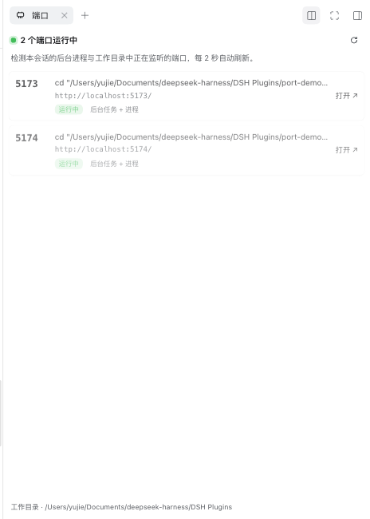

# yujie-dsh-plugin-sider-motion · 会话端口

> DeepSeek Harness 插件：在会话的右侧边栏实时列出「本会话正在监听的端口」，点一下就能在浏览器里打开。

[English](README.en.md) | 中文



---

## 一、这个插件成立的意义

在 Harness 里，“做一个网站”“做一个 API”“给我个预览”这类会话，几乎都会在后台起一个本地服务：`npm run dev`、`vite`、`next dev`、`python -m http.server`、`uvicorn`……

端口号于是只存在于两个地方：**飞速滚动的工具日志**，和**你脑子里**。

这个插件把“本会话正在服务什么”从日志里解放出来，变成一个常驻、可见、可点击的会话级事实。它的意义不只是省几次复制粘贴：

- **把隐性状态变成显性界面。** 会话在跑什么服务、开在哪个端口、还活着没有，一眼可见，而不是靠翻历史消息回忆。
- **让“验证”回归验证本身。** 想看看页面效果，点一下就到，不用在 20 行输出里找 `http://localhost:5173`。
- **让多服务会话可读。** 前端 5173、后端 5174、文档 8000，各自一行，带启动命令和来源，不会点错。
- **会话级隔离。** 端口归属当前会话，而不是全机器端口列表；切会话不会串台。

## 二、解决的问题

| 真实痛点 | 插件的处理方式 |
| --- | --- |
| 端口只出现在滚动的工具输出里，找 URL 靠翻日志 | 从后台任务的命令行与输出中解析端口，常驻右侧栏 |
| 不确定端口是不是还活着（服务可能早退了） | 每个候选做**真实 TCP 探测**，绿点才代表真的在监听 |
| 命令里“提到”端口 ≠ 这个会话在提供该端口 | 命令只采信“启动服务”类命令；输出只采信服务器启动日志 |
| 一个会话起了多个服务，分不清谁是谁 | 每行显示端口号、启动命令、URL、来源标签、工作目录 |
| `127.0.0.1:5173` 打不开（Vite 默认只绑 `[::1]`） | 链接统一用 `http://localhost:PORT/`，探测同时覆盖 IPv4/IPv6 回环 |
| 换会话/换工作区后，之前的端口信息失效 | 端口按会话隔离，进程按工作目录归属 |

## 三、功能一览

- **标题栏入口**：会话标题右侧的端口图标；有端口运行时，图标旁直接显示数量。
- **右侧边栏页**：每个端口一张卡片 —— 状态绿点、端口号、启动命令、可打开 URL、来源（后台任务 / 任务输出 / 工作目录进程）。
- **一键打开**：点击卡片或「打开 ↗」，在新标签页打开该端口。
- **自动刷新**：面板每 2 秒轮询（页面隐藏时暂停），标题栏入口每 5 秒；空状态、错误状态都有明确提示和重试。
- **轻量动效**：面板与列表的入场渐显/上浮，遵守 `prefers-reduced-motion`。
- **跟随主题与语言**：只用宿主 `--dsw-alias-*` 主题变量；中英文文案走 locale 服务。

## 四、它怎么判断“正在运行”

Host 端两路证据 + 一次真实探测，缺一不可：

1. **会话后台任务**（`ctx.jobs`）
   - **命令行**：只有当命令本身是“启动服务”时才采信（`vite`、`next dev`、`npm run dev`、`python -m http.server`、`uvicorn`、`flask run`、`docker compose up`…）。一条 `curl http://localhost:3000` 只是在**提到**端口，不算服务。
   - **输出缓冲**：只有当输出里出现服务器启动日志时才采信（`Local:`、`Network:`、`Listening on`、`Serving HTTP on`、`ready in`…）。
2. **真实监听进程**：用 `lsof -iTCP -sTCP:LISTEN`（Windows 用 `netstat -ano`）枚举本机监听端口，再读取这些进程的工作目录；只有落在**当前会话工作目录**内（含子目录）才归属本会话。
3. **TCP 探测**：对每个候选端口，分别连接 `127.0.0.1` 与 `::1`，任一成功才算“运行中”。
4. **去噪**：已经结束的任务 + 探测失败的端口 = 历史残留，不显示。

## 五、安装

前提：DeepSeek Harness `0.2.x`（桌面版，Web GUI 由本机 HTTP 服务提供）。插件本身零运行时依赖。

### 从中央插件市场安装（推荐）

在 DSH 里打开 **插件 → 发现（Discover）**，添加索引源：

```text
https://raw.githubusercontent.com/yujieco/yujie-dsh-plugins/main/index.json
```

然后在市场里选中「会话端口」，点 **Install**。市场按 Git 提交安装，装到的就是发布时的那份代码。

### 从源码安装

```bash
git clone https://github.com/yujieco/yujie-dsh-plugins.git
```

把 `plugins/sider-motion` 安装为本地 bundle（推荐直接让助手执行）：

```text
plugin_manager
  action: install_bundle
  target: /绝对路径/yujie-dsh-plugins/plugins/sider-motion
```

成功时返回 `application: applied`，插件行 id 为 `sider-motion`。安装即启用。

## 六、打开 / 启用 / 停用

| 操作 | 做法 |
| --- | --- |
| **打开面板** | 进入任意会话 → 标题栏右侧点击端口图标（有端口时带数字）→ 右侧边栏展开「端口」 |
| **启用 / 停用** | 图形界面：设置 → 插件 → 在已安装列表中找到「会话端口 / Session Ports」→ 开关；或让助手执行 `plugin_manager` 的 `set_plugin`，`target: include:sider-motion` |
| **卸载** | `plugin_manager` 的 `remove_bundle`，`target: yujie-dsh-plugin-sider-motion` |

停用后标题栏入口与侧栏页一起消失，不影响会话本身和正在跑的服务。

## 七、使用

在会话里起一个服务（建议用后台任务，进程才能常驻）：

```bash
python3 -m http.server 8000
npm run dev -- --port 5173
```

几秒内右侧栏就会出现对应端口；点整行或「打开 ↗」即可在浏览器查看。服务停掉后，下一次刷新自动消失。

## 八、架构

- **Host 半**（`index.js`）：向 `ctx.webServer` 注册只读路由 `GET /plugin/session-ports/list?sessionId=…`（以及轻量的 `/count`），返回 JSON。路由不带 CORS 头，仅同源 Harness 页面可读；只读本机端口与工作目录，不访问网络、不写会话日志、不注册模型工具。
- **Client 半**（`client.js`）：注册右侧边栏 tab 类型（`ctx.sidebarRightTabs`）、tab 本体与标题（`sidebar.right.pane.tab` / `sidebar.right.pane.tab.title`）、会话标题栏入口（`conversation.session.header.utilities`）。

依赖的公开扩展点：`ctx.webServer`、`ctx.jobs`、`ctx.sessions`、`ctx.workingDirectory`、`ctx.sidebarRightTabs`、`ctx.sidebarRight` 与 slot 体系。

## 九、兼容性与已知边界

- 已在 DSH `0.2.1-rc.5`（macOS，Web GUI）实测：安装、槽位注册、端口探测、点击打开全链路通过。
- 归属规则是“工作目录包含关系”：同一目录下的多个会话会看到同一批端口 —— 它们确实共享这个工程目录。
- 只覆盖 TCP 监听；UDP、Unix domain socket 不显示。
- 需要 `lsof`（macOS/Linux 默认自带）。缺失时仍会显示后台任务解析出的端口，但探测结果取决于实际连通性。
- 如果 Harness 以 `file://` 加载页面（不是本机 HTTP），页面无法访问 Host 路由，插件会给出错误状态而不是崩溃。

## 十、开发

```bash
# client.js 改动：刷新页面即可生效
# index.js 改动：属于 Host，需要禁用/启用一次插件行（plugin_manager set_plugin）来重载
```

目录结构：

```text
index.js           Host 半：扫描端口 + 只读 HTTP 路由
client.js          浏览器半：侧边栏 tab、标题栏入口、轮询与渲染
cordis.patch.yml   插件行（id: sider-motion）
package.json       bundle 与 client 清单
locale/*.json      插件管理器中的标题与描述
icon.svg           插件图标
docs/              README 截图
```
